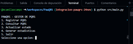

# 🐾 PawQRS — Manual de usuario

**Proyecto integrador:** Algoritmia y Programación 2026-2  
**Universidad:** Universidad de Antioquia  
**Programa:** Ingeniería Industrial  
**Sistema:** PawQRS — Gestor de Peticiones, Quejas, Reclamos y Sugerencias  
**Responsable:** María Camila Ocampo Rúa

---

## 1. ¿Qué es PawQRS?

PawQRS es un sistema desarrollado en Python que permite gestionar Peticiones, Quejas, Reclamos y Sugerencias (PQRS) relacionadas con la atención de perros y gatos en el contexto de MEPEGA.

Su propósito es facilitar el registro, consulta y seguimiento de las solicitudes recibidas, además de proporcionar estadísticas que permitan conocer el comportamiento de las PQRS registradas.

El sistema ofrece cuatro funciones principales:

- Registrar nuevas solicitudes.
- Consultar solicitudes mediante su tipo y número de radicado.
- Actualizar el estado de las solicitudes.
- Generar estadísticas sobre los registros almacenados.

**¿Qué es una PQRS?**

Es una clasificación de las solicitudes que puede presentar una persona:

- **Petición:** solicitud mediante la cual se requiere información, atención o una actuación.
- **Queja:** manifestación de inconformidad frente a una situación o servicio.
- **Reclamo:** solicitud relacionada con una inconformidad por el incumplimiento de una condición o servicio.
- **Sugerencia:** propuesta orientada a mejorar un proceso o servicio.

**¿Qué es el radicado?**

Es un código que permite identificar y localizar una solicitud dentro del sistema. Se genera automáticamente cuando el registro se guarda correctamente.

PawQRS funciona desde una terminal de comandos. No requiere crear una cuenta ni utilizar una interfaz web.

## 2. Requisitos para utilizar el sistema

Para ejecutar PawQRS se necesita:

- Una computadora con Python 3.12 o una versión compatible con las características utilizadas por el proyecto.
- Tener descargado el repositorio PawQRS o abrirlo mediante GitHub Codespaces.
- Acceso a una terminal ubicada en la carpeta principal del proyecto.

El repositorio se encuentra en:

https://github.com/estefaniajimenezj/PawQRS

La carpeta principal debe contener, entre otras, las carpetas `src`, `data` y `docs`.

## 3. ¿Cómo iniciar PawQRS?

Para ejecutar el programa, sigue estos pasos:

1. Abre el repositorio PawQRS en GitHub Codespaces o en un entorno de desarrollo compatible.
2. Abre una terminal desde la carpeta principal del proyecto.
3. Escribe el siguiente comando:

   ```bash
   python src/main.py
   ```

4. Presiona Enter.
5. Si el programa se ejecuta correctamente, aparecerá el menú principal:

   ```text
   PAWQRS - GESTOR DE PQRS

   1. Registrar PQRS
   2. Consultar PQRS
   3. Actualizar estado
   4. Generar estadisticas
   5. Salir
   ```

6. Para utilizar una función, escribe el número correspondiente y presiona Enter.

**Figura 1. Menú principal de PawQRS**



## 4. Opción 1: Registrar una PQRS

Esta opción permite ingresar una nueva solicitud al sistema. Para comenzar, selecciona la opción `1` en el menú principal.

El sistema solicitará la información del solicitante y de la solicitud en el siguiente orden:

### 4.1. Información del solicitante

**1. Nombre completo**

Se ingresa el nombre de la persona que presenta la solicitud. Debe tener entre 3 y 100 caracteres y no puede contener números.

**2. Tipo de documento**

Se selecciona una de las opciones disponibles:

- CC: Cédula de ciudadanía.
- TI: Tarjeta de identidad.
- CE: Cédula de extranjería.
- PP: Pasaporte.
- NIT: Número de Identificación Tributaria.

**3. Número de documento**

Se ingresa el número correspondiente al documento seleccionado. Debe contener entre 3 y 15 dígitos y no debe incluir letras.

**4. Tipo de teléfono**

Se selecciona una de las siguientes opciones:

- Celular.
- Fijo.
- Corporativo.
- Otro.

**5. Teléfono de contacto**

Se ingresa un número de exactamente 10 dígitos.

**6. Correo electrónico**

Se proporciona una dirección de correo electrónico válida para facilitar el contacto con el solicitante.

**7. Dirección**

Este campo es opcional. Se puede ingresar la dirección de residencia o ubicación del solicitante. Si no se desea proporcionar esta información, basta con presionar Enter sin escribir ningún dato.

Cuando se ingresa una dirección, debe tener entre 5 y 200 caracteres y cumplir con los caracteres permitidos por el sistema.

### 4.2. Información de la solicitud

**8. Tipo de solicitud**

Se selecciona la categoría correspondiente:

- Petición.
- Queja.
- Reclamo.
- Sugerencia.

**9. Fecha de radicación**

El sistema asigna automáticamente la fecha en la que se registra la solicitud, utilizando la zona horaria de Colombia. No es necesario ingresarla manualmente.

**10. Canal de recepción**

Se selecciona el medio por el cual fue recibida la solicitud:

- Presencial.
- Correo electrónico.
- Página web.
- Teléfono.
- Redes sociales.
- Otro.

**11. Asunto o título**

Se escribe un título breve que permita identificar el motivo de la solicitud. Debe contener entre 5 y 150 caracteres.

**12. Descripción detallada**

Se explica la situación, petición o inconformidad que se desea registrar. La descripción debe tener entre 20 y 2.000 caracteres.

**13. Tipo de mascota**

Se selecciona una de las opciones disponibles:

- Perro.
- Gato.

**14. Campus relacionado**

Se selecciona el campus al que corresponde la solicitud. El sistema dispone de nueve opciones:

1. Campus Medellín - Ciudad Universitaria.
2. Campus Medellín - Ciudadela Robledo.
3. Campus en el Área de la Salud.
4. Campus Medellín - Sede de Posgrado.
5. Campus Medellín - Edificio San Ignacio.
6. Campus Medellín - Antigua Escuela de Derecho.
7. Campus Medellín - Edificio Antioquia.
8. Campus Medellín - Casas Patrimoniales.
9. Campus Medellín - Edificio de Extensión.

### 4.3. Generación automática del registro

Una vez ingresada la información, el sistema se encarga de completar automáticamente algunos datos:

- **ID:** identificador numérico del registro.
- **Radicado:** código que permite localizar la solicitud.
- **Fecha de radicación:** fecha de registro.
- **Hora de radicación:** hora exacta del registro.
- **Fecha máxima de respuesta:** se calcula sumando 30 días calendario a la fecha de radicación.
- **Estado inicial:** todas las solicitudes comienzan con el estado Registrada.
- **Fecha de solución:** inicialmente permanece vacía, porque la solicitud todavía no ha sido solucionada.

Los radicados utilizan un prefijo según el tipo de solicitud. Algunos ejemplos son:

| Tipo de solicitud | Ejemplo de radicado |
|---|---|
| Petición | PET-0001 |
| Queja | QUE-0001 |
| Reclamo | REC-0001 |
| Sugerencia | SUG-0001 |

La numeración depende de los registros existentes y se maneja de manera independiente para cada tipo de solicitud.

Cuando el registro se guarda correctamente, el sistema informa que la solicitud fue almacenada y muestra su identificación. Posteriormente, intenta generar un comprobante en formato TXT.

**Importante:** si la dirección se deja vacía, el sistema puede mostrarla como `N/A` en la consulta y en el comprobante. Esto significa que el dato no fue proporcionado o no aplica.

**Ejemplo ilustrativo de información ficticia:**

- Nombre: Ana Ejemplo.
- Tipo de documento: CC.
- Número de documento: 123456789.
- Tipo de teléfono: Celular.
- Teléfono: 3001234567.
- Correo: ana.ejemplo@correo.com.
- Dirección: sin información.
- Tipo de solicitud: Petición.
- Asunto: Solicitud de información veterinaria.
- Mascota: Gato.

*Los datos anteriores son únicamente ilustrativos y no corresponden a una prueba real.*

**Figura 2. Registro de una PQRS**

*Insertar una captura real del proceso de registro, utilizando información ficticia.*

**Figura 3. Comprobante de registro**

*Insertar una captura real del comprobante generado por el sistema, sin mostrar información personal verdadera.*

## 5. Opción 2: Consultar una PQRS

Esta opción permite localizar una solicitud previamente registrada y consultar su información.

Para realizar la consulta:

1. Selecciona la opción `2` en el menú principal.
2. Selecciona el tipo de solicitud que deseas consultar.
3. Ingresa el número completo del radicado.
4. El sistema busca el registro correspondiente.
5. Si encuentra la solicitud, muestra la información almacenada, incluyendo los datos del solicitante, la descripción, las fechas y el estado actual.
6. Al finalizar, aparece la pregunta:

   ```text
   ¿Mostrar comprobante? (S/N)
   ```

7. Escribe `S` si deseas mostrar y generar el comprobante, o `N` si no deseas hacerlo.

Si el sistema no encuentra el radicado indicado dentro del tipo de solicitud seleccionado, muestra el mensaje:

```text
No se encontro la PQRS.
```

**Consideración sobre la dirección:** cuando el registro no contiene una dirección, durante la consulta se presenta el valor `N/A`.

**Consideración sobre el comprobante:** al solicitarlo, el sistema lo genera a partir de la información actual del registro. Por lo tanto, puede reflejar los cambios que se hayan realizado en el estado de la solicitud.

**Figura 4. Consulta de una PQRS**

*Insertar una captura real de una consulta exitosa y de la pregunta para mostrar el comprobante.*

## 6. Opción 3: Actualizar el estado de una PQRS

Esta opción permite modificar el estado de una solicitud registrada para realizar seguimiento a su proceso de atención.

Para actualizar el estado:

1. Selecciona la opción `3` en el menú principal.
2. Selecciona el tipo de PQRS.
3. Ingresa el radicado de la solicitud.
4. El sistema identifica el registro y muestra el estado actual y el siguiente estado permitido.
5. Confirma la actualización escribiendo `S` o cancela escribiendo `N`.

El sistema establece una secuencia de estados que debe respetarse:

**Registrada → En proceso → Solucionada**

Cada estado representa una etapa del seguimiento:

- **Registrada:** la solicitud fue recibida y almacenada correctamente.
- **En proceso:** la solicitud se encuentra en proceso de atención.
- **Solucionada:** la solicitud ha finalizado su proceso de atención.

El sistema no permite pasar directamente de Registrada a Solucionada, retroceder a un estado anterior ni actualizar una solicitud que ya se encuentra solucionada.

Cuando una solicitud pasa al estado Solucionada, se registra automáticamente su fecha de solución utilizando la zona horaria de Colombia.

**Figura 5. Actualización del estado de una PQRS**

*Insertar una captura real de una actualización confirmada.*

## 7. Opción 4: Generar estadísticas

Esta opción permite obtener información general sobre las solicitudes almacenadas en el sistema.

Para acceder:

1. Selecciona la opción `4` en el menú principal.
2. El sistema consulta los registros guardados.
3. Presenta los resultados de los diferentes análisis estadísticos.

Las estadísticas incluyen:

### 7.1. Cantidad de solicitudes por tipo

Muestra el número de Peticiones, Quejas, Reclamos y Sugerencias registradas. Permite identificar qué tipo de solicitud tiene mayor frecuencia.

### 7.2. Cantidad de solicitudes por tipo de mascota

Presenta la distribución de las solicitudes relacionadas con perros y gatos. Esto permite conocer a qué tipo de mascota están asociadas las solicitudes registradas.

### 7.3. Cantidad de solicitudes por estado

Muestra cuántas solicitudes se encuentran en cada una de las siguientes etapas:

- Registrada.
- En proceso.
- Solucionada.

Esta información facilita el seguimiento del estado general de las PQRS.

### 7.4. Promedio de días de respuesta

Calcula el promedio de días transcurridos entre la fecha de radicación y la fecha de solución de las solicitudes solucionadas.

Si todavía no existen PQRS solucionadas, el sistema informa que no hay solicitudes solucionadas para calcular este promedio.

### 7.5. PQRS activas más antiguas

Identifica hasta cinco solicitudes activas que llevan más tiempo registradas, ordenándolas desde la más antigua. Esta información permite reconocer solicitudes que requieren seguimiento.

### 7.6. Clasificación de vencimientos

El sistema clasifica las solicitudes activas según su fecha máxima de respuesta:

- **Próximas a vencer:** solicitudes cuyo plazo de respuesta está dentro de los siguientes cinco días.
- **Vencidas:** solicitudes cuya fecha máxima de respuesta ya pasó.

Esta clasificación permite identificar los casos que requieren atención prioritaria.

Si todavía no existen solicitudes almacenadas, el programa muestra un mensaje indicando que no hay registros para generar estadísticas.

**Figura 6. Estadísticas de PawQRS**

*Insertar una captura real de las estadísticas obtenidas con registros ficticios o con datos de prueba autorizados por el equipo.*

## 8. Opción 5: Salir del programa

Para finalizar la ejecución de PawQRS:

1. Selecciona la opción `5` en el menú principal.
2. Presiona Enter.
3. El sistema muestra el mensaje:

   ```text
   Saliendo de PawQRS...
   ```

Después de esto, el programa finaliza su ejecución.

## 9. Almacenamiento de la información

PawQRS almacena las solicitudes en archivos de texto ubicados dentro de la carpeta `data`.

Cada tipo de solicitud cuenta con un archivo independiente:

| Tipo de solicitud | Archivo de almacenamiento |
|---|---|
| Petición | `data/Peticion.txt` |
| Queja | `data/Queja.txt` |
| Reclamo | `data/Reclamo.txt` |
| Sugerencia | `data/Sugerencia.txt` |

Aunque los archivos tienen extensión `.txt`, cada registro se almacena como una línea con información estructurada en formato JSON.

Los comprobantes individuales se guardan en la carpeta:

```text
data/comprobantes/
```

Sus nombres siguen una estructura similar a la siguiente:

```text
Comprobante_QUE_0001.txt
```

**Recomendación:** no se deben eliminar ni modificar manualmente los archivos de almacenamiento, ya que contienen la información utilizada por el sistema. Para realizar demostraciones o pruebas académicas, se deben utilizar datos ficticios y coordinar previamente con el equipo.

## 10. Problemas frecuentes y posibles soluciones

| Problema | Posible solución |
|---|---|
| El sistema muestra «Opción no válida». | Verifica que ingresaste un número correspondiente a una opción del menú. |
| El nombre no es aceptado. | Comprueba que tenga entre 3 y 100 caracteres y que no incluya números. |
| El número de documento es incorrecto. | Ingresa entre 3 y 15 dígitos, sin letras. |
| El teléfono no es aceptado. | Verifica que tenga exactamente 10 dígitos. |
| El correo electrónico es inválido. | Revisa que tenga un formato de correo electrónico válido y que no contenga espacios. |
| La dirección no es aceptada. | Recuerda que es opcional; si la ingresas, debe tener entre 5 y 200 caracteres y cumplir con los caracteres permitidos. |
| No se encuentra la PQRS. | Comprueba que seleccionaste el tipo correcto y que escribiste el radicado completo. |
| No se permite actualizar el estado. | Verifica que la solicitud no esté solucionada y que se respete la secuencia de estados. |
| No aparecen estadísticas. | Comprueba que existan solicitudes almacenadas en los archivos del sistema. |
| El programa no inicia. | Verifica que estás ubicado en la carpeta principal del proyecto y que Python está disponible. |

## 11. Recomendaciones para el uso adecuado

Para garantizar un uso correcto del sistema, se recomienda:

- Ingresar información clara y verídica cuando se gestionen solicitudes reales.
- Revisar los datos antes de finalizar el registro.
- Conservar el número de radicado, ya que permite consultar y actualizar la solicitud.
- Utilizar correctamente las categorías de Petición, Queja, Reclamo y Sugerencia.
- Mantener actualizados los estados de las solicitudes según su proceso de atención.
- Evitar modificar directamente los archivos de almacenamiento.
- Utilizar información ficticia cuando se realicen demostraciones académicas o se tomen capturas para documentación.
- Proteger los datos personales de los solicitantes.

## Control de revisión

- **Responsable:** María Camila Ocampo Rúa.
- **Fecha de revisión:** 25 de noviembre de 2026.
- **Cambios realizados:** revisión del funcionamiento de PawQRS, corrección y organización de las instrucciones de uso, incorporación de la captura del menú principal y verificación de las opciones del sistema.